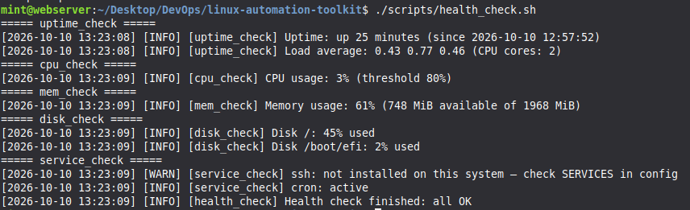
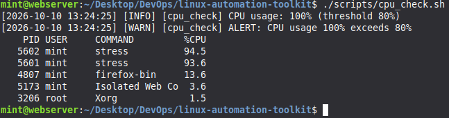
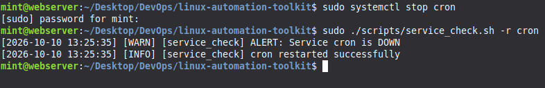
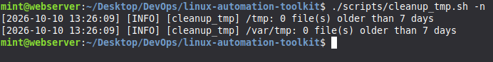
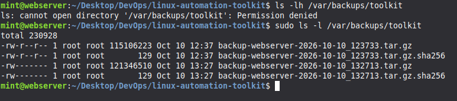
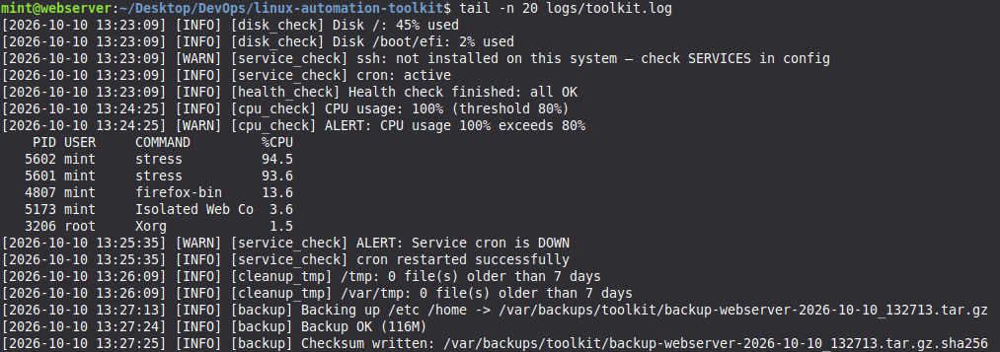

# Linux Server Automation Toolkit


A collection of Bash scripts that automate routine Linux server administration: health monitoring, backups, log management, temp cleanup and user provisioning. The scripts run on a schedule with cron and send alerts when a threshold is crossed.

Checking disk space, restarting a dead service and cleaning up old logs by hand is slow, easy to forget and impossible to do consistently across servers. This toolkit turns those checks into repeatable, logged, scheduled jobs.

```text
CPU > 80%  →  cpu_check.sh  →  logs/toolkit.log  →  Slack / email alert
```

---

## Features

- **Health monitoring:** CPU, memory, disk, load average, processes and systemd services
- **Threshold alerts:** Slack webhook and/or email, with a cooldown so cron doesn't flood you
- **Automated backups:** compressed `tar` archives with SHA-256 checksums, root-only permissions and retention cleanup
- **Log management:** compress old logs, delete very old archives
- **Temp cleanup:** age-based cleanup with a dry-run mode and safety guards
- **User provisioning:** validated usernames, SSH key setup, forced password change on first login
- **One config file:** every threshold and path lives in `config/toolkit.conf`
- **Fails loudly:** empty or invalid config values produce an error, never a silent "all OK"
- **Consistent design:** shared logging library, `-h` help on every script, predictable exit codes

---

## Screenshots

**One command runs every check and ends with a single summary. A service listed in the config but not installed (`ssh` here) is flagged as a config warning, not a failure**


**CPU alert fires when usage (100%) crosses the 80% threshold, listing the `stress` processes responsible**


**A stopped service is detected as DOWN and restarted automatically with `-r`**


**Dry run (`-n`) reports stale files per directory without deleting anything**


**Backups contain `/etc/shadow`, so the destination is root-only (`700`) and archives are created with `umask 077`. Normal users get Permission denied**


<!-- TODO: cron.png -->

**Every event (checks, alerts, restarts, cleanup, backups) is logged with a timestamp, level and script name**


<!-- TODO: slack-alert.png -->

<!-- TODO: github-actions.png -->

---

## Repository Structure

```text
linux-automation-toolkit/
├── .github/
│   └── workflows/
│       └── shellcheck.yml   # Lints every script on push and pull request
├── config/
│   └── toolkit.conf.example # Copied to toolkit.conf by setup.sh
├── docs/
│   └── screenshots/         # Images used in this README
├── logs/                    # Runtime logs (gitignored)
├── scripts/
│   ├── lib/common.sh        # Shared logging, config loading, alerting
│   ├── health_check.sh      # Runs all monitoring checks, one summary
│   ├── cpu_check.sh
│   ├── mem_check.sh
│   ├── disk_check.sh
│   ├── process_check.sh
│   ├── service_check.sh
│   ├── uptime_check.sh
│   ├── backup.sh
│   ├── log_compress.sh
│   ├── cleanup_tmp.sh
│   └── create_user.sh
├── .gitattributes           # Forces LF line endings
├── .gitignore               # Excludes logs/ and the real config
├── setup.sh                 # Permissions, config, cron installation
└── README.md
```

---

## Requirements

- Linux with **systemd** (Ubuntu, Debian, Rocky/RHEL and similar)
- **Bash 4.4+**
- Standard tools: `coreutils`, `procps`, `tar`, `gzip`, `openssl`, `openssh-client` (`ssh-keygen`, for `create_user.sh -k`)
- Optional: `curl` (Slack alerts), `mail` / `mailutils` (email alerts), `stress` (testing)
- Root privileges for `backup.sh`, `create_user.sh`, `service_check.sh -r` and cleaning system directories

Tested on Linux Mint 22.3 (VM).

---

## Quick Start

```bash
git clone https://github.com/EkanayakaSAND/linux-automation-toolkit.git
cd linux-automation-toolkit

./setup.sh                      # makes scripts executable, creates config/toolkit.conf
nano config/toolkit.conf        # adjust thresholds, services, paths

./scripts/health_check.sh       # run your first check
```

To schedule everything with cron:

```bash
sudo ./setup.sh --install-cron
sudo crontab -l                 # verify
```

---

## Configuration

All settings live in `config/toolkit.conf`, which is created from `toolkit.conf.example`.

| Setting | Default | Purpose |
| --- | --- | --- |
| `CPU_THRESHOLD` | `80` | Alert when CPU usage (%) exceeds this |
| `MEM_THRESHOLD` | `85` | Alert when memory usage (%) exceeds this |
| `DISK_THRESHOLD` | `90` | Alert when any filesystem (%) exceeds this |
| `SERVICES` | `ssh cron` | Services checked by `service_check.sh` (use `sshd` on RHEL) |
| `BACKUP_SOURCES` | `/etc /home` | Paths included in backups |
| `BACKUP_DEST` | `/var/backups/toolkit` | Where archives are written |
| `BACKUP_RETENTION_DAYS` | `7` | Delete backups older than this |
| `COMPRESS_LOG_DIRS` | `/var/log/myapp` | Directories scanned for old `.log` files |
| `LOG_COMPRESS_AFTER_DAYS` | `3` | Compress `.log` files older than this |
| `LOG_DELETE_AFTER_DAYS` | `30` | Delete `.log.gz` files older than this |
| `TMP_DIRS` | `/tmp /var/tmp` | Directories cleaned by `cleanup_tmp.sh` |
| `TMP_MAX_AGE_DAYS` | `7` | Delete temp files older than this |
| `ALERT_ENABLED` | `false` | Master switch for external alerts |
| `ALERT_COOLDOWN` | `1800` | Seconds before the same alert can fire again |
| `SLACK_WEBHOOK_URL` | empty | Slack Incoming Webhook URL |
| `ALERT_EMAIL` | empty | Recipient for email alerts |

Command-line flags override config values for a single run. To use a different config file:

```bash
CONFIG_FILE=/path/to/other.conf ./scripts/health_check.sh
```

---

## Scripts

Every script supports `-h` for usage help.

### Monitoring

| Script | What it solves | Usage |
| --- | --- | --- |
| `health_check.sh` | One command shows overall server health | `health_check.sh` |
| `cpu_check.sh` | Detects CPU saturation and shows the top consumers | `cpu_check.sh [-t 90]` |
| `mem_check.sh` | Detects memory pressure using *available* memory | `mem_check.sh [-t 90]` |
| `disk_check.sh` | Catches filling disks before services crash | `disk_check.sh [-t 85]` |
| `process_check.sh` | Lists top processes, counts zombies, checks a named process | `process_check.sh [-n 10] [-s cpu\|mem] [-p nginx]` |
| `service_check.sh` | Verifies critical services are up and can auto-restart them | `service_check.sh [-r] [nginx ssh ...]` |
| `uptime_check.sh` | Reports uptime and load, flags overload and pending reboots | `uptime_check.sh` |

### Maintenance

| Script | What it solves | Usage |
| --- | --- | --- |
| `backup.sh` | Timestamped, verified, root-only backups with automatic retention | `sudo backup.sh [-d /dest] [/path ...]` |
| `log_compress.sh` | Keeps log directories from eating the disk | `log_compress.sh [-n] [/dir ...]` |
| `cleanup_tmp.sh` | Removes stale temp files safely | `cleanup_tmp.sh [-n] [-a 7] [/dir ...]` |
| `create_user.sh` | Consistent, secure user onboarding | `sudo create_user.sh -u alice [-g devs] [-k alice.pub]` |

`-n` runs in **dry-run** mode: it shows what would happen without changing anything. Always try a dry run first.

---

## Exit Codes

| Code | Meaning |
| --- | --- |
| `0` | Everything OK |
| `1` | Usage or configuration error (including empty lists or invalid values in the config) |
| `2` | A check failed or a threshold was crossed |

These codes let `health_check.sh` aggregate results and let other tools (cron wrappers, CI, monitoring agents) react to failures.

---

## Scheduling (Cron)

`sudo ./setup.sh --install-cron` installs:

| Schedule | Job |
| --- | --- |
| Every 5 minutes | `health_check.sh` |
| Daily 02:00 | `backup.sh` |
| Daily 03:30 | `log_compress.sh` |
| Sundays 04:00 | `cleanup_tmp.sh` |

Each line is tagged `# linux-automation-toolkit`, so re-running setup replaces the toolkit's jobs without duplicating them or touching your other cron entries.

---

## Alerts

1. Create a Slack Incoming Webhook (or install `mailutils` for email).
2. In `config/toolkit.conf`:

```bash
   ALERT_ENABLED=true
   SLACK_WEBHOOK_URL="https://hooks.slack.com/services/XXX/YYY/ZZZ"
```

1. Trigger a test alert:

```bash
   ./scripts/cpu_check.sh -t 1
```

Each alert type has its own cooldown key (`cpu`, `disk_/`, `svc_nginx`, …). A disk that stays full therefore sends one alert per cooldown window, not one every 5 minutes. To force an alert again during testing, delete its stamp file, e.g. `rm -f logs/.alert_cpu`.

---

## Testing

```bash
# CPU alert
sudo apt install stress
stress --cpu "$(nproc)" --timeout 60 &
./scripts/cpu_check.sh

# Disk alert
fallocate -l 5G /tmp/bigfile && ./scripts/disk_check.sh; rm /tmp/bigfile

# Service alert + auto-restart
sudo systemctl stop cron
sudo ./scripts/service_check.sh -r cron

# Safe cleanup preview (sudo so root-owned temp files are included)
sudo ./scripts/cleanup_tmp.sh -n

# Backup permissions
sudo ./scripts/backup.sh
ls /var/backups/toolkit            # normal user: Permission denied
sudo ls -l /var/backups/toolkit    # -rw------- archive + .sha256

# Watch everything happen
tail -f logs/toolkit.log
```

Lint all scripts:

```bash
shellcheck -x scripts/*.sh scripts/lib/*.sh setup.sh
```

---

## Design Decisions

- **Shared library (`lib/common.sh`).** Logging, config loading and alerting are written once. Every script behaves the same way and a fix applies everywhere.
- **`set -euo pipefail`.** Scripts stop on errors, undefined variables and failed pipes instead of silently continuing with bad state.
- **Fail loudly on bad config.** An empty `SERVICES` or `TMP_DIRS` list, or a non-numeric threshold, exits with an error. A misconfiguration must never look like a healthy server.
- **CPU from `/proc/stat`.** Two samples one second apart give real utilisation; parsing `top` output is fragile and varies between versions.
- **Memory from `MemAvailable`.** Linux uses free RAM for page cache, so `MemFree` makes healthy servers look full. `MemAvailable` reflects what applications can actually use.
- **Explicit `PATH`.** Cron runs with a minimal environment. Setting `PATH` avoids the classic "works manually, fails in cron" bug.
- **Alert cooldown.** Monitoring that spams gets muted. One alert per issue per window keeps alerts meaningful.
- **"Not installed" is not "down".** A configured service that doesn't exist on the host is reported as a config warning, so a typo or a missing package doesn't trigger a false outage alert.
- **Backup verification.** Every archive gets a `.sha256` checksum, and `tar` exit code 1 (files changed while being read) is a warning, not a failure.
- **Safety guards.** Cleanup refuses `/`, stays on one filesystem (`-xdev`), skips `systemd-private-*` directories, handles filenames with spaces (`-print0`) and supports dry runs. `backup.sh` refuses `/` (and forms like `//` or `/./`) as a source.

---

## Security Considerations

- `config/toolkit.conf` is **gitignored** and created with `chmod 600`, because it can contain webhook URLs and other secrets. Only the `.example` file is committed.
- `backup.sh` runs with `umask 077` and sets the destination directory to `700`, because archives contain credential files such as `/etc/shadow`. Archives and their `.sha256` files are readable by root only.
- `create_user.sh` validates usernames, group names and shells, rejects private keys or invalid public keys passed to `-k`, prints temporary passwords **once to the terminal and never to the log file**, and forces a password change on first login with `chage -d 0`.
- When an SSH key is provided, password login is locked and `.ssh` / `authorized_keys` get strict permissions (`700` / `600`).
- Only scripts that need root call `require_root`. Monitoring checks run as a normal user.

---

## Limitations

- `log_compress.sh` is a learning exercise. On production systems, **`logrotate`** is the standard tool: it signals applications to reopen log files, which plain `gzip` does not.
- Modern distros already clean `/tmp` with **`systemd-tmpfiles`**, so `cleanup_tmp.sh` is most useful for custom temp directories. `systemd-private-*` directories (used by services with `PrivateTmp=`) are skipped on purpose.
- Cron jobs run as root, so `logs/` and the alert cooldown files become root-owned. Run `sudo chown -R "$USER":"$USER" logs/` before manual runs as a normal user.
- Alerts use simple string-built JSON; messages with unusual characters may need proper escaping (e.g. with `jq`).
- The toolkit monitors a single host. It is not a replacement for Prometheus, Zabbix or similar systems.

---

## Roadmap

- [ ] `remote_check.sh`: run health checks across multiple servers over SSH
- [ ] Inode usage monitoring
- [ ] Telegram / Discord alert support
- [ ] `logrotate` config for the toolkit's own log
- [ ] Off-server backup upload (e.g. AWS S3)

---

## Author

**Nirmana Ekanayaka**
[GitHub](https://github.com/EkanayakaSAND) · [LinkedIn](https://linkedin.com/in/nirmana-ekanayaka)
